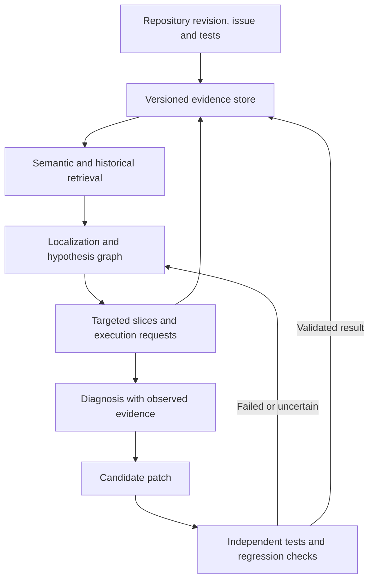

# Debugging Architecture Review

Related: [[Research Proposal]] · [[Relevant Papers]] · [[Sub-agent Context Architecture]]

Prepared: 2026-10-28. Focus: RQ1, repository-scale debugging and vulnerability detection.

This review reconstructs eight core systems and two supporting studies from their primary papers. Each linked note is a separate architecture block with a diagram, maintained state, scope boundaries and a proposed experiment. Diagrams are simplified reconstructions, not copied figures or implementation specifications. The improvement sections are our research hypotheses, not established results or claims of novelty.

## Reading map

| Paper block | Role in our design | First question to test |
|---|---|---|
| [[01 ARISE]] | Repository representation | Does crossing function boundaries improve localization? |
| [[02 RepoAudit]] | Demand-driven auditing | Can validated summaries support deeper investigations? |
| [[03 PracRepair]] | Execution-aware diagnosis and repair | Does trace feedback help after autonomous localization? |
| [[04 TraceCoder]] | Agent specialization | Do separate roles help when tools and budget are held fixed? |
| [[05 GraphLocator]] | Symptom-to-cause reasoning | Can executions confirm or refute inferred causal links? |
| [[06 Repository Memory]] | Historical context | When does memory help, become stale, or distract? |
| [[07 RepoLens]] | Semantic context | Do conceptual concerns find better slice seeds? |
| [[08 ProtocolGuard]] | Executable verification | Can we reproduce findings using trustworthy oracles? |
| [[09 VulTriage]] | Vulnerability context selection | Which context channel resolves the actual uncertainty? |
| [[10 VulnGym]] | Evaluation design | Where does the pipeline lose correct evidence? |

Primary citations and section references are inside each note. The remaining items in the supplied shortlist are deferred from this focused pass, not judged irrelevant. General coding-agent platforms remain implementation/comparison candidates rather than the main subject here.

## Proposed integration — a hypothesis to evaluate

The strongest candidate contribution is **consistent, queryable evidence across localization, reproduction, diagnosis and repair**. Merely combining agents, graphs, traces and memory would be insufficient. The individual notes show which of these capabilities already exist.

A practical shared record should carry:

- Repository revision, stable entity identity and source span.
- Claim or observation, with its source tool and assumptions.
- Supporting and contradicting evidence identifiers.
- Status: hypothesis, statically supported, observed, reproduced, or regression-checked.
- Execution identity: test, input, environment and trace reference.
- Dependencies and invalidation rules after a patch.

Agents can exchange references to those records through NLIP, while MCP exposes retrieval and execution tools. This is our proposed design, not a capability established by the reviewed papers. Neither protocol itself guarantees correct evidence, useful coordination or lower token use.

## What to implement and compare first

Start with one debugging lane: issue → localization → reproduce → diagnose → patch → regression tests. Treat compilation or reproduction failure as a measured outcome. Add vulnerability hunting as a separate lane with its own finding oracle and metrics.

Use a staged experiment to avoid confounding several changes:

1. One agent with ordinary repository and test tools.
2. The same agent plus structured repository context.
3. The same tools/context with specialized agents.
4. Add shared evidence state and revision-aware reuse.
5. Add runtime evidence and trace-difference feedback.
6. Compare reference-based communication with ordinary artifact exchange.

Hold the model, information access and total budget constant where possible. Report correct repair rate, localization recall, independently confirmed findings, reproduction rate, unsupported claims, repeated exploration, tokens, execution cost and wall-clock time. Include index construction and maintenance; amortize them only over a stated number of tasks.

Do not combine headline scores across these papers: their tasks, languages, supplied fault information, models and correctness criteria differ. In particular, supplied locations, historical future fixes and oracle endpoints must never leak into a claimed autonomous end-to-end result.

## Individual architecture blocks

![[01 ARISE]]

---

![[02 RepoAudit]]

---

![[03 PracRepair]]

---

![[04 TraceCoder]]

---

![[05 GraphLocator]]

---

![[06 Repository Memory]]

---

![[07 RepoLens]]

---

![[08 ProtocolGuard]]

---

![[09 VulTriage]]

---

![[10 VulnGym]]
