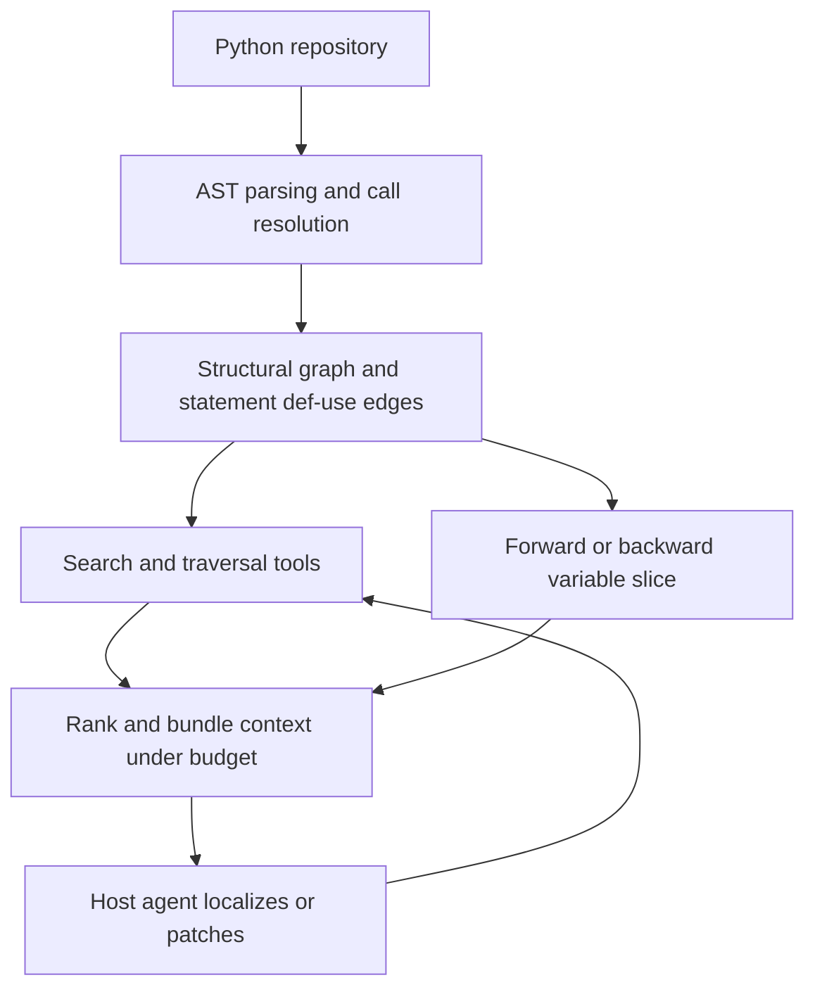

# ARISE

[[Debugging Architecture Review|Back to comparison]] · Priority: core representation baseline

**Scope and evidence.** A graph/tool layer for repository localization and repair, evaluated on Python SWE-bench Lite; it plugs into a host agent. Reconstruction from [ARISE v2, §§3, 5–6](https://arxiv.org/html/2605.03117v2), July 2026.

## Architecture block

**State and context.** Cached typed graph, source locations, entity index and enclosing scopes. The agent retrieves code spans, slices and ranked context bundles. Def-use extraction uses a lightweight within-function scan, not a complete semantic model.

**Limitations reported by the paper.** Slices stop at calls; dynamic dispatch is omitted from call resolution. Wrong-file localization remains a major failure mode. Better localization does not guarantee correct multi-location edits. See §§3.2–3.3 and 5.2.

## Scope for improvement — our proposal

Add interprocedural summaries connecting arguments, returns and side effects; retain uncertainty for unresolved calls. Attach runtime observations to confirm candidate dependencies. Invalidate summaries when their source or dependencies change.

**Experiment.** Compare structural retrieval, local slicing, and cross-function slicing under the same model, host and budget. Stratify bugs by call-chain depth; measure localization recall, correct repairs, graph-building cost and total tokens. A larger graph alone is not the contribution: demonstrate that the additional dependencies change successful diagnoses.
