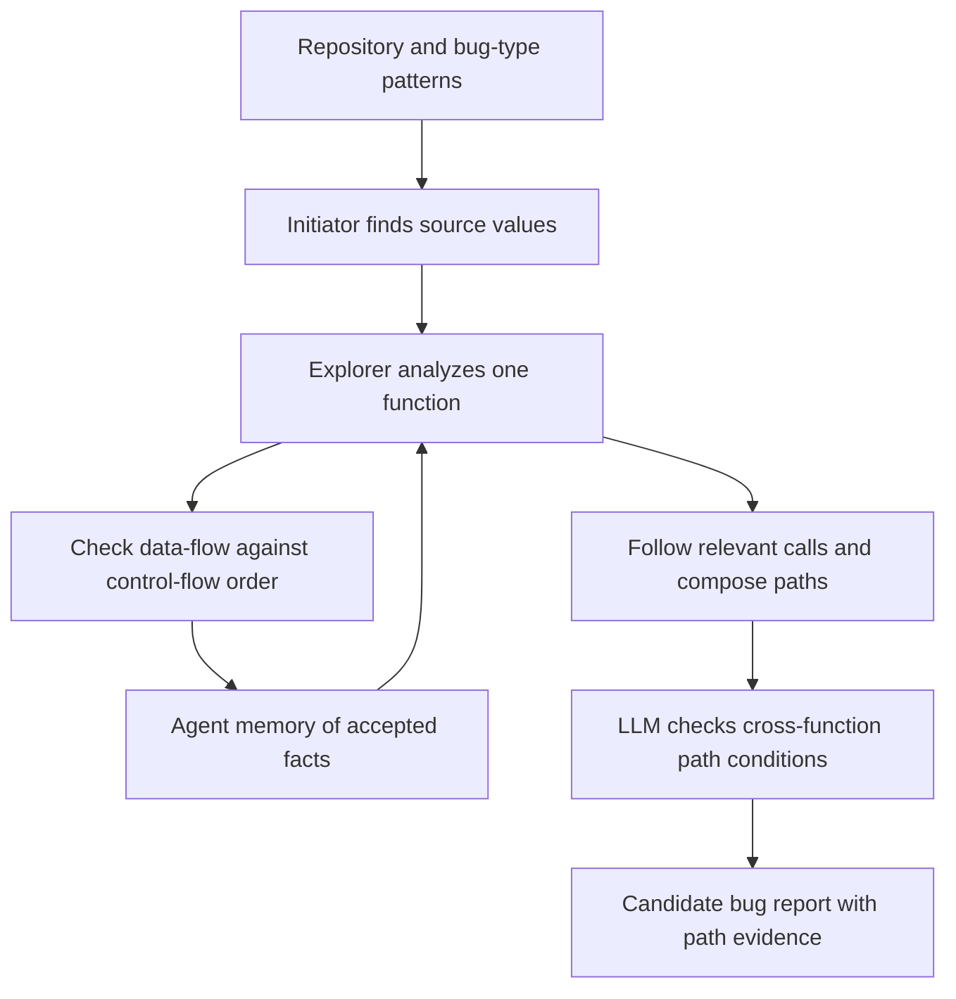

# RepoAudit

[[Debugging Architecture Review|Back to comparison]] · Priority: core vulnerability baseline

**Scope and evidence.** Repository auditing for null dereferences, memory leaks and use-after-free. Reconstruction from [RepoAudit, §§3–4](https://arxiv.org/html/2501.18160); [ICML 2025 publication](https://proceedings.mlr.press/v267/guo25n.html).

## Architecture block

**State and context.** Shared analysis memory avoids repeated function analysis; prompts cover abstraction, pointer behavior and feasible paths. Validation combines parsing-based order checks with LLM feasibility reasoning.

**Limitations / scope boundaries.** The evaluation bounds calling context to four functions. Supported bug types require source-pattern configuration. Feasibility checking is not an SMT proof or executable reproduction; the pipeline audits rather than repairing. These boundaries follow §§3–4.

## Scope for improvement — our proposal

Extend facts into revision-aware evidence objects carrying assumptions, source spans and validation status. Reuse summaries across deeper chains, then generate targeted reproduction tests for uncertain findings. Connect confirmed findings to a separate repair-and-regression loop.

**Experiment.** At a fixed exploration budget, compare bounded exploration with summary-guided deeper exploration. Report precision, independently confirmed defects, reproduction success, repeated analyses and costs. Never describe memory itself as our novelty: this baseline already has it. The testable distinction is evidence reuse across revisions, tasks and verification stages.
