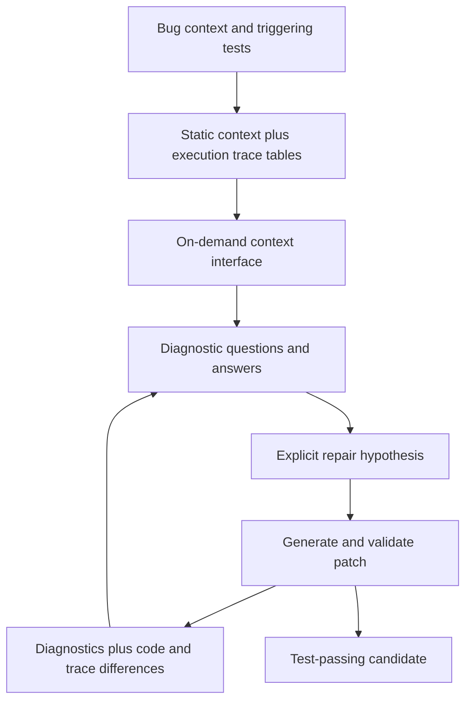

# PracRepair

[[Debugging Architecture Review|Back to comparison]] · Priority: core execution-aware repair baseline

**Scope and evidence.** Java repair using failing executions, evaluated on Defects4J and RWB. Reconstruction from [PracRepair, §§III–VI](https://arxiv.org/html/2606.17612v1), June 2026.

## Architecture block

**State and context.** Static relations, statement execution/value tables, diagnostic history, repair hypothesis and validation feedback. Queries inspect definitions, callers, def-use relations, execution paths and runtime states.

**Limitations reported / evaluated scope.** Main results assume exact buggy statements; a separate experiment removes that assumption. Evaluation is Java-only. Tests establish plausibility, while correctness assessment additionally uses reference fixes or manual review. Larger repositories and other languages remain external-validity questions (§VI-B).

## Scope for improvement — our proposal

Connect this diagnostic loop to repository-wide localization without oracle locations. Let each question request a minimal cross-function evidence slice and a targeted execution, then preserve hypothesis provenance across agents.

**Experiment.** Start every system from the same repository, issue and available tests. Compare pass/fail feedback against trace-difference feedback with equal budgets. Measure end-to-end correct repairs, diagnostic rounds, trace volume and execution overhead; assess patches with held-out regression tests. Keep supplied-location results separate from autonomous localization results.
