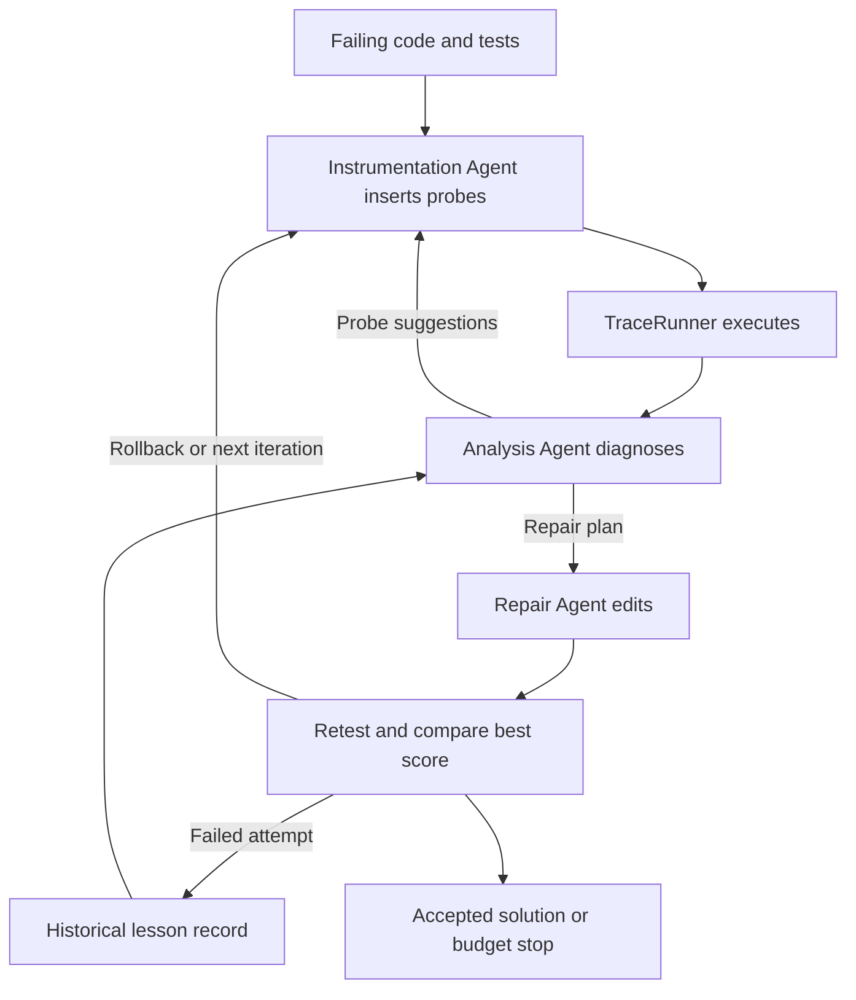

# TraceCoder

[[Debugging Architecture Review|Back to comparison]] · Priority: core multi-agent repair reference

**Scope and evidence.** Debugging LLM-generated code. Reconstruction from [TraceCoder, §3](https://arxiv.org/html/2602.06875v1), February 2026.

## Architecture block

**State and context.** Traces, repair plans, probe suggestions, failed-attempt lessons and best-performing code/test count. Agents communicate sequentially through shared artifacts rather than direct messages.

**Scope boundaries.** Lessons are reused within the same problem instance. The studied setting is generated-code debugging, not arbitrary large-repository maintenance. Rollback uses test performance; it is not a semantic-correctness guarantee.

## Scope for improvement — our proposal

Give each agent a task-specific view of a shared repository model instead of repeatedly transferring broad code context. Store validated lessons with revision and applicability constraints. Track individual test identities, not only counts, and distinguish a failed hypothesis from an instrumentation failure.

**Experiment.** Hold tools and model fixed while comparing one agent with the three-role loop, then add shared repository state. Measure correct repairs, repeated failed hypotheses, communication tokens and trace overhead. Test explicit NLIP messaging against artifact exchange separately; messaging should earn its complexity through measurable benefits.
