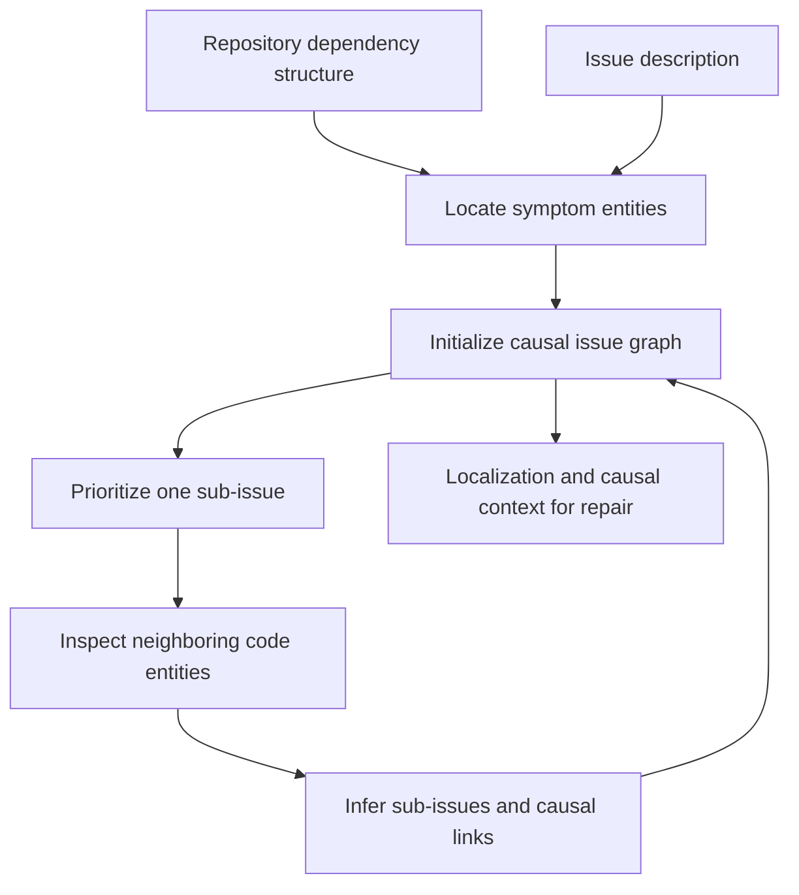

# GraphLocator

[[Debugging Architecture Review|Back to comparison]] · Priority: causal localization reference

**Scope and evidence.** Issue-to-code localization across Python and Java. Reconstruction from [GraphLocator, §§2–3 and 6](https://arxiv.org/html/2512.22469v1), December 2025 preprint; [FSE 2026 paper](https://conf.researchr.org/details/fse-2026/fse-2026-research-papers/130/GraphLocator-Graph-guided-Causal-Reasoning-for-Issue-Localization).

## Architecture block

**State and context.** Repository dependency graph; a separate causal issue graph mapping sub-issues to code; expansion priorities and visited entities. The causal graph guides reasoning from symptoms toward related causes.

**Limitations / interpretation.** The authors identify a continuing gap between localization and correct patches. Causal links are inferred explanations, not experimentally established causation. Evaluation covers Python/Java; patch-derived location labels may exclude alternative valid fixes (§6).

## Scope for improvement — our proposal

Give every causal edge an evidence status: hypothesized, statically supported, observed, or contradicted. Require important edges to yield a falsifiable prediction, such as a particular variable becoming invalid before the visible failure. Use targeted executions to update those statuses.

**Experiment.** Compare graph reasoning alone with evidence-checked expansion. Measure localization precision/recall, rejected causal hypotheses, reproduction rate and downstream correct repairs. Include cases with multiple affected functions and distant symptom/root-cause locations; do not score persuasive explanations as verified causes.
