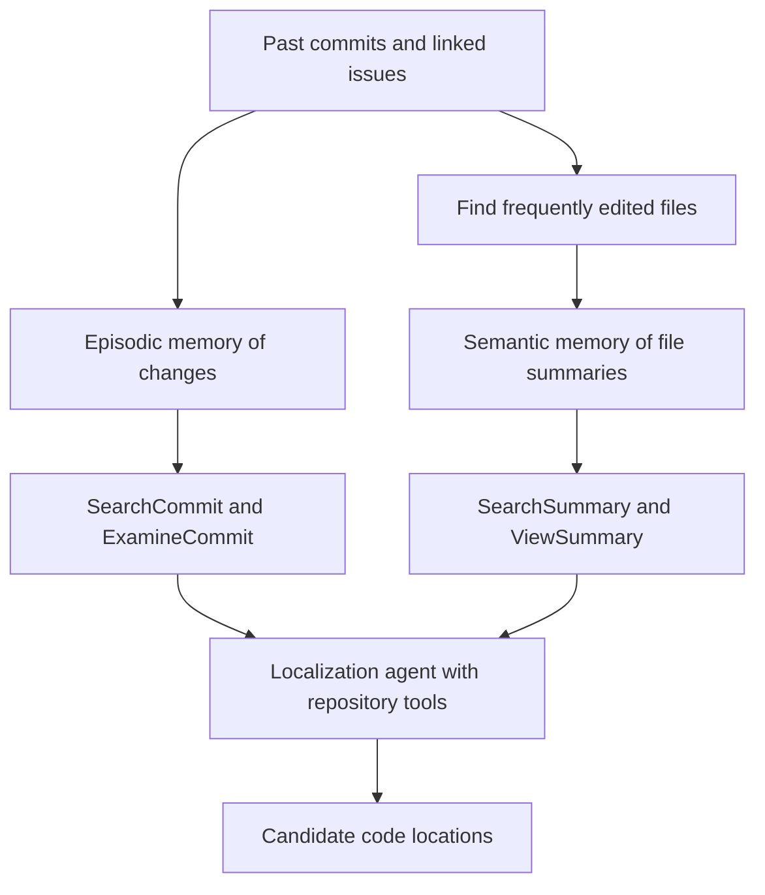

# Improving Code Localization with Repository Memory

[[Debugging Architecture Review|Back to comparison]] · Priority: persistent memory baseline

**Scope and evidence.** Memory augmentation of localization agents. Reconstruction from [ICLR 2026 paper, §§3–4](https://proceedings.iclr.cc/paper_files/paper/2026/file/b4c06f095368497f3ac19422efef8133-Paper-Conference.pdf).

## Architecture block

**State and context.** Historical patches/metadata and summaries of active files. The agent retrieves history and functional descriptions alongside current-code tools. Construction excludes future commits and filters overlapping target issues to reduce leakage.

**Limitations reported.** Novel issues or weak retrieval can return distracting history; sparse-history repositories can perform worse than the baseline. Summaries concentrate on actively edited files. The paper studies localization, not a complete execution-and-repair memory system.

## Scope for improvement — our proposal

Separate historical precedent from evidence about the current revision. Add freshness checks, confidence-based retrieval gating and an explicit fallback when history is irrelevant. Store verified reproduction recipes and failed hypotheses as distinct records, with their dependency fingerprints.

**Experiment.** Evaluate sequential issues using strict time cutoffs. Compare no memory, historical memory and validated execution memory. Report negative transfer, retrieval relevance, repeated exploration and amortized maintenance cost. Include sparse-history and recently refactored repositories; success only on familiar modules would not establish general repository understanding.
