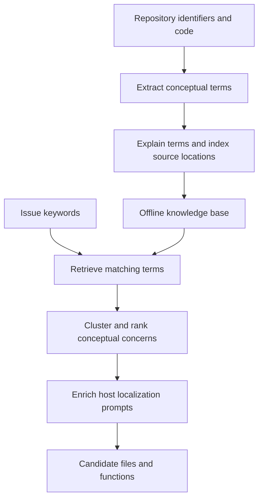

# RepoLens — Extracting Conceptual Knowledge to Locate Software Issues

[[Debugging Architecture Review|Back to comparison]] · Priority: semantic representation baseline

**Scope and evidence.** Concept-enhanced issue localization. Reconstruction from [RepoLens v2, §§3 and 5](https://arxiv.org/html/2509.21427v2), October 2025.

## Architecture block

**State and context.** Terms, explanations and file/function mappings persist offline; issue-specific concerns collect scattered functionality online. Structural relationships, including calls, inform clustering.

**Limitations reported.** The system lacks deeper slicing, control/data-flow analysis and execution traces. Integration is through prompt modification rather than a dedicated concern-aware agent. These limits are explicit in §5.1. Evaluation concerns localization; semantic similarity alone does not establish an executable failure path.

## Scope for improvement — our proposal

Use concerns as search seeds, then ground each concern in source spans, dependencies and observed executions. Maintain separate semantic and execution views so a useful conceptual grouping cannot silently become a claimed causal relation. Refresh affected terms after edits.

**Experiment.** Compare semantic retrieval, graph retrieval and semantic-seeded slices with equal context budgets. Measure recall for dispersed bugs, irrelevant context volume, index/update cost and downstream correct repairs. Include an ablation of the semantic layer: retaining it is justified only if it discovers useful starting points that structural search misses.
