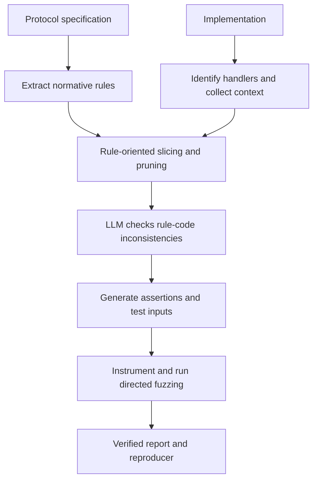

# ProtocolGuard

[[Debugging Architecture Review|Back to comparison]] · Priority: concrete verification reference

**Scope and evidence.** Specification non-compliance in C network-protocol implementations. Reconstruction from [NDSS 2026 paper, §III, Figure 1 and §VI](https://www.ndss-symposium.org/wp-content/uploads/2026-f521-paper.pdf).

## Architecture block

**State and context.** Rules, handler context, slices, inconsistency reports, assertions and test inputs link the specification to executable checks.

**Limitations reported.** Handler-centric slices can miss callback logic; conservative indirect-call resolution can add irrelevant code. Implementation support is C-focused. Generated assertions may be wrong because their generator lacks runtime state. Fuzzing effectiveness limits verification (§VI).

## Scope for improvement — our proposal

Generalize the verification contract to observable bug properties while preserving an independent source of expected behavior: regression tests, documented contracts or trusted reference behavior. Supply runtime states when constructing assertions. Mark findings separately as suspected, reproduced, repaired and regression-checked.

**Experiment.** Measure how many static candidates become independently validated failures, plus assertion accuracy and reproduction time. Audit generated oracles against trusted expectations; a candidate and its confirming assertion can share the same mistaken assumption. Keep protocol-specific evaluation separate from general repository debugging.
