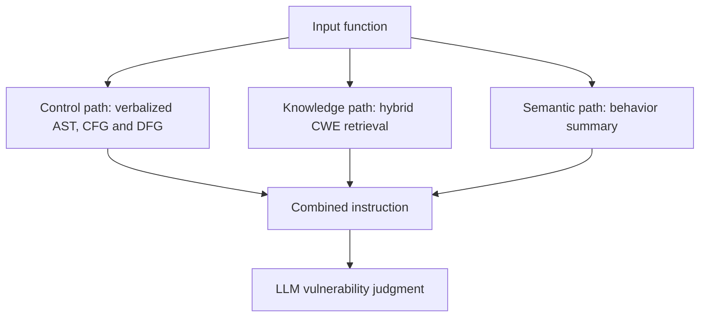

# VulTriage

[[Debugging Architecture Review|Back to comparison]] · Priority: supporting vulnerability-context study

**Scope and evidence.** Function-level vulnerability detection, with PrimeVul and Kotlin evaluation. Reconstruction from [VulTriage v2, §3 and Appendix A](https://arxiv.org/html/2605.09461v2), May 2026.

## Architecture block

**State and context.** Structural descriptions, retrieved weakness patterns/examples and a behavioral explanation feed the judgment. This is context augmentation, not a demonstrated repository exploration-and-repair workflow.

**Limitations reported.** Evaluation mainly classifies functions rather than locating precise vulnerable statements. Project-specific rules and historical patches are absent from the external context. Context assembly uses a fixed three-path design; adaptive selection is proposed as future work (Appendix A).

## Scope for improvement — our proposal

Apply vulnerability context only after repository exploration identifies a candidate slice. Select context channels according to the uncertainty: control constraints, external-input reachability, or a missing project invariant. Require a source-to-operation evidence chain before escalating a classification to a repository finding.

**Experiment.** Compare fixed context assembly with adaptive selection under equal token limits. Report classification precision separately from repository discovery, line localization and reproducibility. Use paired benign/vulnerable cases to test whether extra context distinguishes subtle changes rather than merely triggering more positive predictions.
