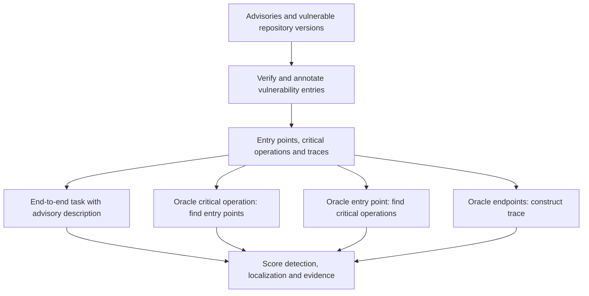

# VulnGym

[[Debugging Architecture Review|Back to comparison]] · Priority: supporting evaluation framework

**Scope and evidence.** Repository vulnerability benchmark, not a repair-agent architecture. Reconstruction from [VulnGym, benchmark and evaluation sections](https://arxiv.org/html/2608.02001v1), August 2026.

## Architecture block

**State and context.** Vulnerable snapshots and line-level annotations define evidence chains. End-to-end agents receive an advisory title/description; the three diagnostic subtasks reveal selected ground truth.

**Scope boundaries / our interpretation.** Advisory-guided detection differs from unrestricted discovery. Oracle-assisted results must remain separate from end-to-end performance. Detecting an annotated chain does not measure patch correctness or prove an executable exploit.

## Scope for improvement — our evaluation proposal

Adopt separate measures for exploration, localization and evidence quality, then add reproduction and repair validation as extra stages. Preserve the published task definitions for comparison and label all extensions explicitly.

**Experiment.** Compare the same agent with and without shared context on each task. Add repeated-file reads, unsupported trace edges, total tokens and execution time. Use verified reachability evidence where feasible. Check whether better localization actually produces better traces and repairs rather than assuming the stages improve together.
