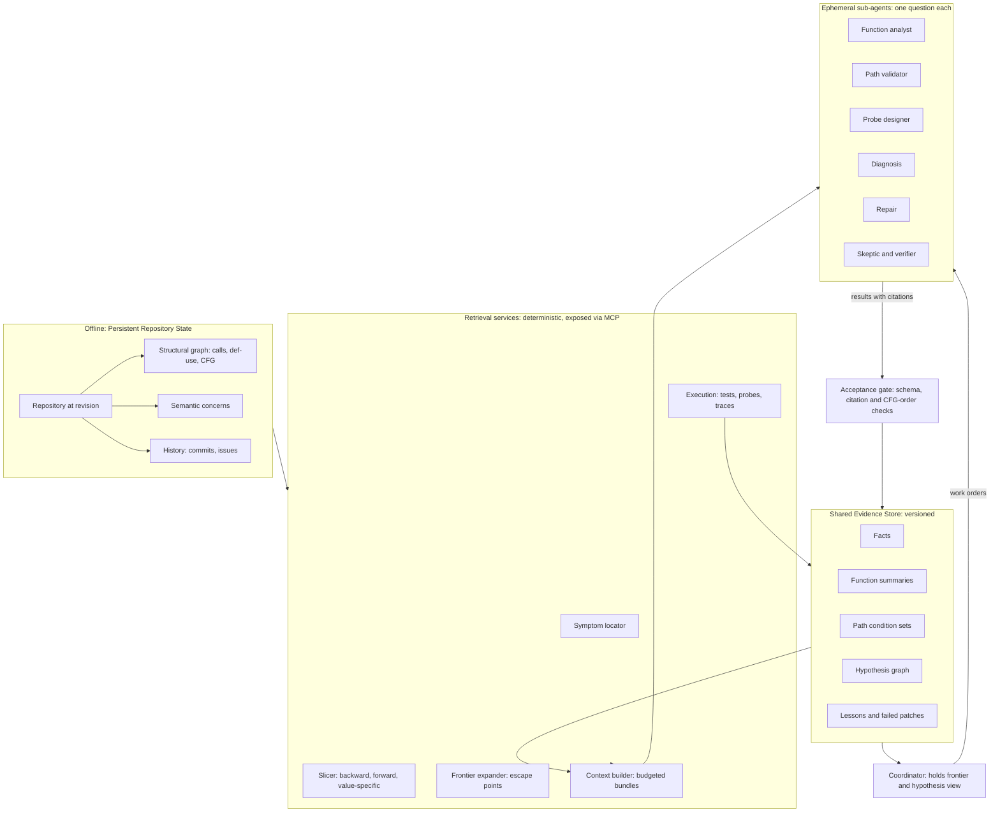
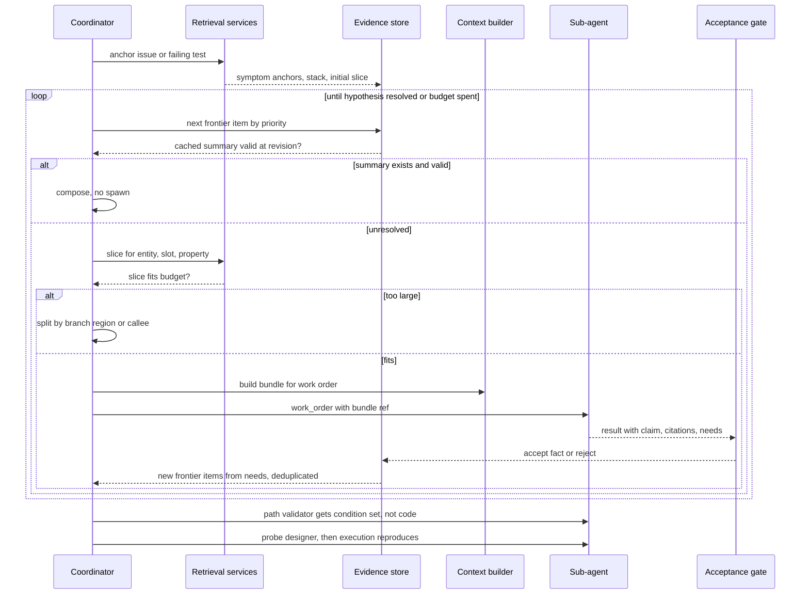

# Sub-agent Context Architecture

Related: [[Debugging Architecture Review]] · [[02 RepoAudit]] · [[Research Proposal]]

Prepared: 2026-10-28. Focus: context management and retrieval for repository-scale QA, across all three research questions.

This note diagnoses why RepoAudit's context management limits it. It then proposes an architecture in which retrieval narrows each problem *before* any sub-agent is spawned, so each sub-agent receives one atomic question and a budgeted evidence bundle. The same context architecture serves debugging, optimization and concurrency. NLIP is the communication layer underneath; it is evaluated separately and is not the main contribution. Statements marked **[paper]** come from RepoAudit (arXiv 2501.18160) or ECMA-430. Statements marked **[ours]** are our interpretation or design and still need testing.

---

## 1. The claim

RepoAudit already decomposes auditing into one-function steps with a memory, so "add decomposition and memory" is not new. Its limits sit in **what each step is given, what each step leaves behind, and how steps are composed**:

- The LLM performs retrieval inside the reasoning prompt.
- Memory stores path-specific results rather than reusable summaries.
- Cross-function context accumulates as concatenated text.
- One trajectory serializes work that is actually independent.

We propose to move retrieval out of the LLM, turn memory into revision-scoped **summaries with conditions**, and spawn short-lived sub-agents only after deterministic narrowing. Each sub-agent answers exactly one question and returns facts, never raw code or reasoning transcripts.

### Contribution structure

| Part | Contribution | Where in this note |
|---|---|---|
| **1. Context-management architecture (main)** | Find → narrow → spawn retrieval, parametric summaries, structured path conditions, a shared frontier and an evidence store. The design is task-agnostic. | §§2–6 |
| **2. Application to the three QA areas** | The same architecture with area-specific question kinds and context channels: debugging and vulnerabilities (RQ1), optimization (RQ2), concurrency (RQ3). | §7 |
| **3. Communication layer and other areas** | NLIP as the inter-agent transport, measured on whether it adds value over a plain transport carrying identical payloads. Other cross-cutting work, such as guardrails and cost, also sits here. | §§8, 10 |

**Rule [ours]:** Part 1 results must hold with a plain transport. Passing evidence by reference rather than by summary is a *context-management* decision and is tested in Part 1. Part 3 asks only whether carrying those same messages over NLIP changes anything.

---

## 2. Where RepoAudit's context management breaks

Reported cost **[paper, §4.2 Table 2]**: about 100.67 prompting rounds, 614,626 input tokens and 46,153 output tokens per project, about 0.44 h and $2.54. Without the memory cache, prompts rise about 3.55× and cost about 3.48× (App. C, Table 7).

**[ours]** Input outweighs output roughly 13:1, at about 6.1K input tokens per round. The system therefore spends most of its tokens on context, not on reasoning output. Better selection of that context is the main lever.

| # | Cause | What the paper shows | Consequence **[ours]** |
|---|---|---|---|
| C1 | **Retrieval happens inside the reasoning prompt** | The unit is a whole function. "Abstraction" (selecting relevant statements) is a step hint *inside* the analysis prompt, not a separate pass (§3.2.1, Fig. 4). Removing abstraction raises false positives (App. C, Table 6). | The model must find the relevant lines and reason about them in the same call. With complex control flow it "becomes more susceptible to hallucinations." Retrieval errors become reasoning errors. |
| C2 | **Memory is a cache, not a summary** | Memory maps `(function, value)` to a set of `(path, data-flow facts)` pairs (§3.2.1). It is reused only when the same pair recurs (§3.2.2). | A result for `p` does not transfer to `q` in the same function. Nothing records a function's general behavior, such as "returns NULL when `len == 0`." Each new source, bug type, task or revision re-analyses the function. |
| C3 | **Path conditions are not first-class** | Stored items are paths and facts; conditions are not listed separately. The validator receives the *concatenated* inter-procedural path and asks the LLM for contradictions (§3.3). Reports are concatenated fact chains (§3.2.3). | Validation context grows with chain length. **[ours, inference]** This growth is a plausible practical reason for the K = 4 depth bound (§4), although the paper attributes K to prior auditing work. The paper itself says the bound misses longer chains (§4.3). |
| C4 | **One serialized trajectory per source** | Each source starts its own scan (§3.1). Overhead is "highly sensitive to the number of sources" (§4.3). | Independent frontier items wait in sequence. Overlapping scans share work only when `(function, value)` keys match exactly. |
| C5 | **Missing context channels** | Main failure cause is hallucination (§2.2, §4.3). Examples: an error-handling path the model overlooked (FN, App. A); YANG schema constraints it did not know (FP, App. F). Future work requests "compilation-free analysis of branches and loops" (§4.3). | The prompt lacks explicit control-flow structure, project invariants and domain constraints. The model must infer them, or it fails. |
| C6 | **Validation shares the explorer's evidence type** | Order checking is parsing-based, but feasibility is an LLM judgement over the same text (§3.3). No execution is performed. | A plausible but wrong chain can pass if the model makes the same mistake twice. No independent observation breaks the tie. |
| C7 | **Memory scope ends with the run** | Memory serves one audit run of one agent pipeline. | Nothing carries across bug types, tasks, revisions or cooperating agents. This is where our shared evidence store differs from RepoAudit's memory (see [[02 RepoAudit]]: "never describe memory itself as our novelty"). |

**Summary [ours]:** RepoAudit decomposes *work* well but not *context*. Every step still carries raw code, and every composition step carries all earlier steps.

---

## 3. Design principles

1. **Deterministic retrieval, LLM reasoning.** Graphs, slicers, escape analysis, CFG extraction, trace collection and ranking run as tools. The LLM never receives a whole function when a value-specific slice exists.
2. **Find, then narrow, then spawn.** A sub-agent is created only after retrieval has reduced the question to one entity, one slot (parameter, return, field, global), one property and one bundle within the token budget. If the question can be settled without an LLM, no sub-agent is spawned.
3. **Facts flow; reasoning does not.** Sub-agents return schema-validated claims with citations. Their chains of thought, explorations and drafts are discarded. Later agents see only validated facts, so one agent's hallucination cannot silently become another agent's context.
4. **References, not content.** Messages carry evidence IDs. The runtime dereferences them into a budgeted bundle only when an agent actually needs them. This holds whatever the transport is.
5. **Everything is revision-scoped and has a status.** Each record carries the revision, the source spans it depends on, its assumptions and one status: `proposed → checked → observed → reproduced → regression-checked`, or `refuted`. A patch or refutation invalidates dependants.

---

## 4. Architecture



**What runs long and what stays short:**

- Long-lived: the evidence store and the retrieval services.
- Turn-by-turn: the coordinator. Its prompt is **re-rendered each turn from the store**: frontier table, open hypotheses and budget left. It does not accumulate chat history, so its context does not grow with investigation length.
- Short-lived: sub-agents. Each is created for one work order and discarded after its result is gated.

**Division of protocols:** MCP connects agents to tools (slicer, graph, tests). NLIP connects agents to agents. The evidence store sits behind both.

---

## 5. The find → narrow → spawn loop



### Spawn policy

| Situation | Action |
|---|---|
| A valid summary for `(entity@rev, slot, property)` exists | Reuse it; do not spawn |
| Static tools settle it, e.g. non-nullable type or no escape | Record a `checked` fact; do not spawn |
| Slice fits the budget and asks one property | Spawn one function analyst |
| Slice exceeds the budget | Split by branch region or callee, then spawn per piece; never truncate |
| Several properties of the same slice | Batch into one work order to amortize the fixed prompt cost |
| Complete source-to-symptom chain in the fact graph | Spawn a path validator over the **condition set** |
| Feasible but unobserved chain | Spawn a probe designer, then run execution |
| Hypothesis refuted | Cancel its outstanding work orders; record a lesson |

**How exploration becomes shared [ours]:** A sub-agent never explores on its own. If it needs a callee's behavior, it returns `needs: [callee summary for _merge_defaults.return may_be_None]`. The coordinator deduplicates that need against the store and every pending order. RepoAudit's demand-driven expansion therefore moves from one private trajectory to a shared, deduplicated frontier that several agents work in parallel.

**Why depth stops being bounded by context [ours, hypothesis]:** At each step a sub-agent sees the caller's slice plus the callees' **summaries**, not their code. The path validator sees a list of conditions, not a concatenated path. Per-step context stays roughly constant as chains get longer, so depth is limited by budget rather than prompt size. This must be measured (§10), not assumed.

### Worked example: crash on an empty config file

1. Execution reproduces the crash. The locator anchors `serializer.py:181`, where `obj` is `None`.
2. The slicer runs backwards from `obj`. The frontier expander finds that `obj` enters through the return value of `transform_config`.
3. The store has no summary for `transform_config.return may_be_None`. The slice is 40 lines, so the coordinator spawns **one** analyst with a 3K-token bundle: the slice, its CFG with early exits marked, and the callee summary for `_merge_defaults` if one exists.
4. The analyst returns the claim `may_be_None when cfg == {}`, citing the branch spans, and adds `needs: parse_config.return may_be_empty_dict`.
5. That need becomes a new order. Its answer completes the chain from parse to transform to serializer.
6. The path validator checks the three conditions. The probe designer writes an empty-file input. Execution observes `None` at line 118, so the chain becomes `reproduced`.
7. Diagnosis receives three fact references and one trace reference, not three files. The verifier rejects a patch that only adds a `None` check in the serializer, because the reproduced root cause is upstream. A lesson records that rejection, following TraceCoder.

---

## 6. Evidence objects

| Record | Key fields | Origin |
|---|---|---|
| **Slice** | anchor, direction, spans, CFG fragment with early exits marked, unresolved calls | ARISE; answers RepoAudit's request for branch and loop analysis (C1, C5) |
| **Fact** | entity@rev, slot, property, condition, citations (span IDs), status, assumptions (fact IDs) | RepoAudit facts, made condition-explicit (C3) |
| **Summary** | entity@rev, slot → property under conditions; parametric, not tied to one value; source fingerprint | Generalizes RepoAudit memory (C2) |
| **Path condition set** | ordered fact IDs, conditions as structured predicates | Replaces concatenated paths (C3) |
| **Trace** | test or input, environment, observed values at spans | PracRepair, TraceCoder (C6) |
| **Hypothesis** | causal edge, supporting and contradicting evidence, status | GraphLocator plus evidence status |
| **Lesson** | rejected patch or refuted hypothesis, reason, applicability conditions | TraceCoder (C7) |
| **Context bundle** | work-order ID, ranked evidence IDs, token count, channels used | ARISE budgeted bundles; VulTriage-style channel choice |

**Invalidation:** each record lists the spans and records it depends on. An edit to a span or a refuted dependency moves every dependant back to `proposed`.

---

## 7. Applying it to the three QA areas (Part 2)

The core does not change between areas: the store, the find → narrow → spawn loop, the acceptance gate and the coordinator are shared. Each area plugs in three things: **anchors** (where retrieval starts), **question kinds** (what one sub-agent may be asked) and **context channels** (what a bundle may contain). Baselines are from [[Relevant Papers]].

| | RQ1 Debugging and vulnerabilities | RQ2 Optimization | RQ3 Concurrency |
|---|---|---|---|
| **Anchors** | Failing test, stack trace, issue text, vulnerability sources | Profiler hotspots on a benchmark workload | Race or deadlock report, failing interleaving, shared-variable accesses |
| **Retrieval before spawn** | Backward slice from the symptom; escape points | Map hot frames to call paths; slice the data that drives the hot loop | Static happens-before view; lock sets; threads touching each shared variable |
| **Atomic question kinds** | `slot_property`: can this return or parameter be NULL, freed or tainted, and when? | `cost_property`: what in this region scales with input size, and what invariant must an optimization keep? | `access_property`: which locks guard this access, and can it run concurrently with that access? |
| **Summary type** | Value-flow contract: parameter or return → property under conditions | Cost contract: complexity driver, allocations, side effects | Synchronization contract: locks held or released, shared state touched, thread entry |
| **Path-level check** | Feasible source-to-symptom condition set | Hot path still semantically equivalent after the change | Feasible interleaving: ordered access pair with no common lock |
| **Execution evidence** | Reproduction test, traces, sanitizers | Repeatable benchmark: runtime, memory, storage; tests for correctness | Controlled scheduling (e.g. Fray), race detectors |
| **What "verified" means** | Reproduced, fixed, regression-checked | Measured speed-up beyond noise, with tests passing | Interleaving reproduced, then no longer reproducible after the fix, with tests passing |
| **Baselines** | RepoAudit, SWE-agent, OpenHands | PerfAgent, ACCLAIM; SWE-Perf and SWE-fficiency benchmarks | ConFixAgent; Spaghetti Bench / Fray |

**What carries over across areas [ours]:**

- A function summary records value-flow, cost and synchronization facts side by side, under one revision fingerprint. An optimization that changes a function therefore invalidates the concurrency and value-flow facts that depend on it.
- A verified optimization becomes a candidate for a concurrency check if it touches shared state. A debugging fix can likewise trigger a performance regression check. Cross-area triggering is a design option to evaluate, not a starting requirement.

**Order of work:** build the core with RQ1, since RepoAudit gives a direct baseline. Then add RQ2 and RQ3 as plug-ins. Count how much of the core each new area reuses unchanged; that count is direct evidence that the context architecture generalizes.

---

## 8. Communication layer: NLIP (Part 3)

NLIP is how agents exchange the work orders and results defined above. The context-management benefits in Part 1 come from *what* is exchanged: references, facts and needs. NLIP determines *how* those messages travel. Part 3 measures whether that choice matters (§10).

These mappings follow **ECMA-430, 1st edition, December 2025 [paper]**:

- A message is a JSON first submessage with `MessageType` (optional), `Format`, `Subformat` and `Content`, plus an ordered `Submessages` array. Field names are case-insensitive. Each submessage has an optional `Label`.
- Formats are `text`, `token`, `structured` (`json`, `uri`, `xml`, `html`, or a programming language), `binary`, `location` and `generic`.
- `MessageType: "control"` is reserved for non-functional negotiation. Any other value is a data message interpreted by the receiver.
- A received `token` submessage must be echoed back unchanged unless the receiver created it. `conversation` and `authentication` prefixes are reserved; other token subformats are application-defined.
- Large content can move out of band: a control request returns a `structured/uri` endpoint (§6.4).

### How we use each field [ours]

| NLIP element | Use in our system |
|---|---|
| `MessageType` | `work_order`, `result`, `evidence_request`, `evidence_response`, `challenge`, `verdict`, `invalidate`, `cancel` |
| `structured/json` first submessage | The typed payload: question, budget and answer schema; or claim, citations and needs |
| `structured/uri` submessages | Evidence references such as `ev://repo@a1b2c3/slice/SL-81`, dereferenced by the runtime |
| `token/conversation_<agent>` | Investigation ID; the echo rule gives free request/response correlation |
| `token/workorder` (application token) | Work-order ID, echoed in the result |
| `text/english`, labelled `intent` | At most one sentence of human-readable intent, for logs; never needed for correctness |
| `Label` | Role of each submessage: `bundle`, `assumption`, `trace`, `intent` |
| `control` | Capability queries ("which evidence kinds do you support?"), budget policy, out-of-band transfer of large traces |

### Work order (coordinator → function analyst)

```json
{
  "messagetype": "work_order",
  "format": "structured", "subformat": "json",
  "content": {
    "schema": "sleuth.work_order/v1",
    "question": {
      "kind": "slot_property",
      "entity": "py:parser.config.transform_config@a1b2c3",
      "slot": "return",
      "property": "may_be_None"
    },
    "assumptions": ["FACT-77"],
    "budget": { "input_tokens": 6000, "output_tokens": 600 },
    "answer_schema": "sleuth.fact/v1"
  },
  "submessages": [
    { "label": "bundle", "format": "structured", "subformat": "uri",
      "content": "ev://repo@a1b2c3/bundle/CB-0142" },
    { "label": "investigation", "format": "token", "subformat": "conversation_coordinator",
      "content": "DEBUG-104" },
    { "label": "order", "format": "token", "subformat": "workorder",
      "content": "WO-0142" },
    { "label": "intent", "format": "text", "subformat": "english",
      "content": "Can transform_config return None for an empty parsed config?" }
  ]
}
```

### Result (function analyst → acceptance gate → store)

```json
{
  "messagetype": "result",
  "format": "structured", "subformat": "json",
  "content": {
    "schema": "sleuth.fact/v1",
    "status": "answered",
    "claim": {
      "entity": "py:parser.config.transform_config@a1b2c3",
      "slot": "return", "property": "may_be_None",
      "condition": { "var": "cfg", "op": "==", "value": {} },
      "cites": ["SPAN-114-121", "SL-81#n4"]
    },
    "confidence": "medium",
    "needs": [
      { "kind": "slot_property",
        "entity": "py:parser.config.parse_config@a1b2c3",
        "slot": "return", "property": "may_be_empty_dict" }
    ]
  },
  "submessages": [
    { "label": "investigation", "format": "token", "subformat": "conversation_coordinator",
      "content": "DEBUG-104" },
    { "label": "order", "format": "token", "subformat": "workorder",
      "content": "WO-0142" }
  ]
}
```

### Acceptance gate [ours]

These checks run before a result can enter the store. They are cheap, and they directly target RepoAudit's hallucination failure mode:

1. **Schema:** the payload validates against `answer_schema`.
2. **Citation grounding:** every `cites` ID was present in the bundle the agent received. A claim citing unseen code is rejected.
3. **CFG order:** RepoAudit's parsing-based order check, applied to the cited spans.
4. **Assumption closure:** every assumption is an accepted fact.

Results that fail go back once with the failure reason, then are dropped and logged as an unsupported claim.

---

## 9. Mapping causes to mechanisms

| Cause | Mechanism | Borrowed from |
|---|---|---|
| C1 retrieval inside the prompt | Slicer plus CFG with early exits marked, delivered as a budgeted bundle | ARISE, RepoAudit §4.3 future work |
| C2 cache, not summary | Parametric, revision-scoped summaries keyed by `(entity, slot, property)` | RepoAudit memory, generalized |
| C3 concatenated paths | Path condition sets referencing fact IDs; validator never sees code | RepoAudit validator, restructured |
| C4 serialized trajectory | Shared, deduplicated frontier; parallel ephemeral sub-agents | TraceCoder roles; GraphLocator priority |
| C5 missing channels | Channels chosen by the open uncertainty: CFG, invariants or schemas, history, traces | VulTriage, RepoLens, Repository Memory |
| C6 single evidence type | Probe design plus execution; skeptic agent with no stake in the hypothesis | ProtocolGuard, PracRepair |
| C7 run-scoped memory | Evidence store shared across agents, tasks and revisions, with invalidation | Repository Memory, plus our status lattice |

---

## 10. Experiments

Hold model, temperature (0.0, as in RepoAudit §4), tools and total token budget fixed in every comparison.

### Part 1: context management (main result)

Run on RepoAudit's own benchmark and bug types (NPD, memory leak, use-after-free) first, so differences are attributable. All runs use the same plain transport (in-process JSON calls), so NLIP plays no part in these results.

| Run | Adds | Isolates |
|---|---|---|
| A0 | RepoAudit as published | baseline |
| A1 | Deterministic slice and CFG bundle in place of whole function | C1 |
| A2 | Parametric summaries in place of `(function, value)` cache | C2 |
| A3 | Structured condition sets; remove K = 4, bound by budget | C3; tests the depth hypothesis |
| A4 | Parallel ephemeral sub-agents over a shared frontier, **exchanging fact references** | C4 |
| A4′ | Same agents and frontier, but **exchanging natural-language summaries** | references vs summaries, a context-management question |
| A5 | Execution-backed validation | C6 |
| A6 | Cross-task and cross-revision store reuse | C7 |

### Part 2: the three areas

For each area, compare against that area's baselines (§7) with the same model and budget, and run two ablations:

- **Context off:** the same agents, given ordinary repository tools instead of the find → narrow → spawn bundles. This shows the architecture's effect within the area.
- **Core reuse:** the share of core components used unchanged by the area's plug-in. This shows generality.

Area-specific outcomes: correct repairs and confirmed findings (RQ1); measured speed-up, memory and storage change with tests passing (RQ2); reproduced and repaired races or deadlocks (RQ3).

### Part 3: communication layer and other areas

Take the best Part 1 configuration and change **only** the transport: plain in-process calls vs NLIP over HTTP or WebSocket, with identical payloads.

- Overhead: bytes per message, latency, message-handling failures.
- Outcome stability: task results should match Part 1 within noise. A difference indicates a transport bug, not a benefit.
- What NLIP enables: agents in separate processes or hosts, heterogeneous models per role, and adding an agent without changing others. Report these as capabilities, with their cost.

Guardrails and policy enforcement (AgentSpec, LlamaFirewall, Maris in [[Relevant Papers]]) can be studied here as well, since they act on messages rather than on context.

### Measures for all parts

- True positives and precision, with independently confirmed findings.
- Input tokens per true positive, prompting rounds and wall-clock time.
- **Repeated analyses**: the same entity, slot and property analysed more than once.
- **Mean and maximum tokens per sub-agent prompt.**
- Maximum confirmed chain depth.
- **Citation-rejection rate**, as a hallucination proxy.
- Summary reuse rate, and invalidations per edit.
- Index construction and maintenance cost, amortized over a stated number of tasks.

Stratify results by call-chain depth; A3 must show gains specifically on chains longer than 4.

Then move to the debugging lane on SWE-bench-style issues, keeping supplied-location results separate from autonomous localization (as noted in [[Debugging Architecture Review]]).

---

## 11. Risks and open questions

- **Wrong summaries propagate.** Mitigations: summaries start `proposed`; only `checked` or higher summaries are reused across tasks; refutation invalidates dependants. Measure how often a reused summary is later refuted.
- **Spawn overhead.** Each sub-agent pays a fixed system prompt. Mitigations: prompt caching of the shared prefix, batching same-slice questions, and no spawn when a tool can decide. Granularity is a tunable to measure, not a fixed rule.
- **Slicer imprecision.** Dynamic dispatch, aliasing and callbacks are weak spots, as ARISE and ProtocolGuard report. Unresolved calls must appear in the bundle as explicit unknowns, not be silently dropped.
- **Coordinator becomes the bottleneck.** Its rendered view must stay bounded. Show the top-N frontier items plus counts, and keep everything else in the store.
- **References may not beat summaries.** A4 vs A4′ decides this. If references do not reduce tokens or repeated analysis at equal accuracy, drop the evidence-reference claim from Part 1.
- **NLIP overhead without benefit.** Part 3 may show only overhead. That is an acceptable result: report NLIP as the transport we used, with its cost, rather than as a source of gains.
- **Area plug-ins may not share much.** If RQ2 or RQ3 needs most of the core rewritten, the generality claim weakens. Report the reuse count honestly.
- **Language coverage.** RepoAudit targets C/C++; our debugging lane targets Python. The slicer and CFG tools are per-language, while the protocol and store are not.

---

## Sources

- Guo et al., *RepoAudit*, [arXiv 2501.18160](https://arxiv.org/html/2501.18160): §§2–4, App. A, C, E, F; [ICML 2025](https://proceedings.mlr.press/v267/guo25n.html)
- [ECMA-430: Natural Language Interaction Protocol, 1st ed., Dec. 2025](https://ecma-international.org/wp-content/uploads/ECMA-430_1st_edition_december_2025.pdf), §§5–6
- [NLIP specification repository](https://github.com/nlip-project/nlip_spec) (bindings ECMA-431–433, security profiles ECMA-434)
- Remaining systems as cited in their notes: [[01 ARISE]], [[03 PracRepair]], [[04 TraceCoder]], [[05 GraphLocator]], [[06 Repository Memory]], [[07 RepoLens]], [[08 ProtocolGuard]], [[09 VulTriage]]
